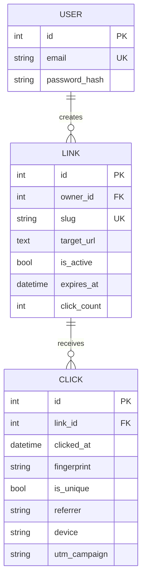

# System design notes

## Components

- **Web UI:** server-served HTML/CSS/JavaScript, fetch API, keyboard shortcuts, no Node runtime.
- **Authentication:** Argon2 password hashing, 7-day signed JWT session cookie, CSRF token bound to session, same-origin policy for registration and sign-in.
- **Link service:** slug generation, validation, lifecycle controls, QR endpoint, public 302 redirects.
- **Event collector:** click event (link ID, timestamp, pseudonymous daily visitor fingerprint, referrer hostname, device/browser, UTM).
- **Analytics:** SQL owner-scoped event retrieval and aggregation into daily series, visitor estimate, referrer/device/browser/campaign breakdowns; CSV export.
- **Storage:** SQLite by default, PostgreSQL through SQLAlchemy/psycopg and Docker Compose; Alembic revision for schema management.
- **Cache:** optional 60-second Redis slug cache. Cache invalidated on link updates and deletions. Redis enables fixed-window auth/link creation throttles.

## Main database relationships

## Performance and growth roadmap

1. **Higher-volume writes:** Queue redirect click events (e.g., Redis Streams, Kafka) and aggregate asynchronously to reduce synchronous database writes. Current pipeline writes per click for straightforward consistency and learning.
2. **Approximate global uniques:** Replace link/day HMAC estimates with a privacy-reviewed approximate cardinality data structure for high traffic.
3. **Analytics scale:** Pre-aggregate daily/hourly facts, partition events by date, index owners and time intervals, establish a retention window.
4. **Production safety:** abuse reporting, malicious destination review, domain reputation checks, email verification, session revocation and request throttling independent of Redis availability.
5. **Observability:** dashboards for redirect latency, click write failure rates, database saturation and cache hit ratio, structured tracing.

## Known tradeoffs

The redirect route performs a synchronous database commit to avoid dropping events. This favors correctness and approachability over maximal throughput. Cached metadata cuts slug lookups but does not eliminate click writes. The single-instance SQLite mode is appropriate for local demonstrations and should not be mistaken for a globally scalable production architecture.
